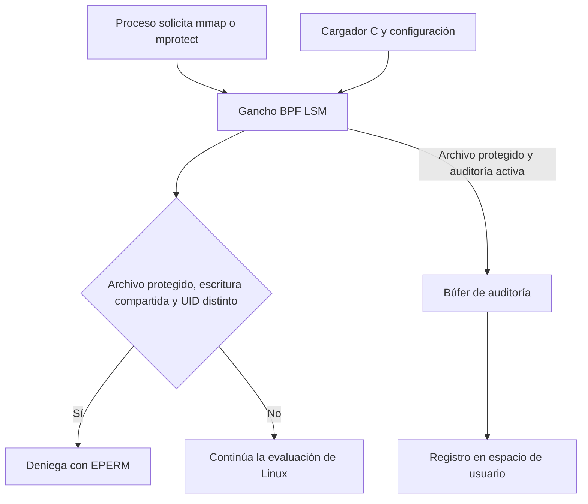

# Diseño de la defensa para archivos mapeados con mmap

**Parte II · Estrategia con apoyo de IA**

Universidad EAFIT · Sistemas Operativos · 2026-2

## Objetivo y arquitectura seleccionada

La solución aplica control de acceso en el kernel mediante **BPF LSM**, con dos programas eBPF en C y un cargador en C basado en libbpf. La política protege un archivo regular de prueba de ext4. Una vez activa, deniega las solicitudes de escritura compartida sobre ese archivo a los procesos cuyo **UID real** difiera del UID expresamente autorizado.

El permiso POSIX del archivo y las demás políticas de Linux siguen aplicándose. En la demostración, ambas cuentas tenían acceso de escritura por POSIX al archivo de prueba. Eso permite atribuir el rechazo adicional a nuestra política y distinguirlo del comportamiento ordinario del sistema.

| Elemento | Decisión de diseño |
| --- | --- |
| Archivo protegido | Una vez abierto y verificado como archivo regular, se registra por dispositivo e inodo. El cargador conserva un descriptor durante la sesión para mantener vivo el objeto registrado. El nombre puede cambiar sin que cambie la identidad del archivo. |
| Identidad del solicitante | El UID real en el espacio inicial de usuarios. En Linux v6.12 corresponde a los 32 bits inferiores de `bpf_get_current_uid_gid()`. La demostración usa dos cuentas de prueba sin cambios de identidad. |
| Registro del archivo | El cargador obtiene `st_dev` y `st_ino` mediante `fstat()`. El programa en kernel obtiene el dispositivo del superbloque y el número de inodo. El contrato de la clave emplea números separados de dispositivo mayor y menor y un inodo de 64 bits. Se cotejaron las representaciones de dispositivo con ambas interfaces y se verificó la identificación del inodo en la VM. |
| Creación de mapeos | `mmap_file` examina la protección efectiva y el tipo obtenido con `MAP_TYPE`. Una solicitud con `PROT_WRITE` y tipo `MAP_SHARED` o `MAP_SHARED_VALIDATE` se deniega con `EPERM` si el archivo está protegido y el UID real difiere del configurado. |
| Cambios de protección | `file_mprotect` examina el archivo y las banderas de cada VMA. Con `VM_MAYSHARE` y `PROT_WRITE` solicitado en la protección efectiva, aplica la misma regla. En v6.12 `VM_MAYSHARE` conserva la información de mapeo compartido incluso cuando Linux limpia `VM_SHARED` por permisos del descriptor. La prueba usó un descriptor con permiso de escritura para observar la decisión del gancho. |
| Resto de solicitudes | La política deja continuar la operación si el archivo queda fuera del alcance, el mapeo carece de escritura compartida o el UID es el autorizado. El programa conserva cualquier denegación previa que reciba de la cadena BPF LSM. |
| Auditoría | Los ganchos registran solicitudes observadas sobre el archivo protegido. Cada evento incluye instante, PID, UID real, identificación del archivo, operación, permisos y decisión de esta política. Un fallo al reservar espacio en el búfer se contabiliza y la decisión se aplica igualmente. Se distingue la decisión del gancho del resultado final de la llamada al sistema. |

La configuración se carga con la política inactiva. El cargador activa la política después de conectar ambos ganchos. Si falla una conexión, aborta la puesta en marcha y libera los recursos. La réplica observó ambos enlaces activos y comprobó la limpieza ante un fallo simulado en la segunda conexión. [Registro de carga](../evidencias/carga_bpf.log) · [Prueba de fallo](../evidencias/fallo_conexion_bpf.log)

El flujo presupone que la cadena recibida permite evaluar la solicitud. La auditoría puede habilitarse o deshabilitarse durante la medición para estimar su coste por separado.

**Referencias.** [BPF LSM](https://docs.kernel.org/6.12/bpf/prog_lsm.html) · [Ganchos](https://github.com/torvalds/linux/blob/v6.12/include/linux/lsm_hook_defs.h#L196) · [Implementación de los ganchos](https://github.com/torvalds/linux/blob/v6.12/security/security.c#L2976) · [MAP_SHARED y MAP_SHARED_VALIDATE](https://github.com/torvalds/linux/blob/v6.12/mm/mmap.c#L380) · [Cambios en una VMA](https://github.com/torvalds/linux/blob/v6.12/mm/mprotect.c#L778) · [UID en el helper BPF](https://github.com/torvalds/linux/blob/v6.12/kernel/bpf/helpers.c#L238) · [Dispositivo mayor y menor en el kernel](https://github.com/torvalds/linux/blob/v6.12/include/linux/kdev_t.h) · [BPF ring buffer](https://docs.kernel.org/6.12/bpf/ringbuf.html)

## Matriz de seguridad y rendimiento

| Alternativa | Control y cobertura | Impacto y condición de uso |
| --- | --- | --- |
| **BPF LSM sobre mapeo y cambio de permisos** | Puede denegar operaciones en los puntos elegidos y emitir un evento por solicitud observada. | En la medición original sobre el archivo protegido, el p50 de `mmap()` aumentó 13,7 % con política sin auditoría y 60,7 % con auditoría. Requiere BPF LSM activo. [Medición original](resultados_etapa5.md) |
| **LSM compilado en el kernel** | Puede aplicar la misma política y admite una integración más profunda si el diseño la requiere. | La lógica ejecutada en el gancho tiene un coste medible. Cambiar el kernel aumenta el trabajo de compilación, distribución y validación. |
| **Trazado eBPF con kprobes o fexit** | Permite observar llamadas, resultados y fallos de página. La decisión de acceso requiere un punto de control adecuado. | El volumen de eventos aumenta si se instrumentan fallos de página. Sirve para diagnóstico y medición puntual. |
| **Controlador LKM con su propio callback de mmap** | Puede gobernar los mapeos de su dispositivo, como en el laboratorio del curso. | Requiere gestionar la vida de las regiones y crece el coste si interviene por página. El archivo regular de ext4 usa las operaciones de su sistema de archivos. |
| **Intercepción de la tabla de llamadas con LKM** | Depende de que el despacho nativo use esa tabla. En x86-64 v6.12 el despacho pasa por `x64_sys_call()`. | La alternativa carece de un coste comparable en el kernel de referencia porque reemplazar la entrada de la tabla no interpondría ese despacho. |

Los ganchos seleccionados actúan al solicitar el mapeo o una protección. Los accesos rutinarios mediante traducciones ya instaladas siguen la ruta de hardware. El diseño protege la integridad frente a nuevas escrituras **compartidas por mapeo**. Los mapeos escribibles previos a la activación, un mapeo autorizado heredado y otras operaciones de E/S quedan fuera del alcance de esta política. La auditoría tampoco cuenta cada lectura o escritura de memoria. La política deja leer por mapeo según los permisos ordinarios del sistema.

**Referencias.** [Despacho nativo x86-64](https://github.com/torvalds/linux/blob/v6.12/arch/x86/entry/syscall_64.c) · [Kprobes](https://docs.kernel.org/6.12/trace/kprobes.html) · [Modelo de libbpf](https://docs.kernel.org/6.12/bpf/libbpf/libbpf_overview.html) · [Laboratorio de referencia](https://github.com/evalenciEAFIT/SO2026B/tree/63c4cca30fd5de9480a1e2a654042834d1e936c0/USOS/CapaKernel)

## Flujo de trabajo con IA

1. **Exploración.** El asistente propuso puntos de intervención y contrastó las alternativas con fuentes de Linux v6.12. El diseño fijó los ganchos, la identidad del archivo y el alcance de la política.
2. **Código en C.** Se usó IA para redactar y revisar el programa eBPF, el cargador, las estructuras compartidas y la prueba en espacio de usuario. Se cotejaron los argumentos de los ganchos, las banderas y los permisos con las fuentes y los encabezados. Clang, GCC, el verificador y la carga en la VM aportaron comprobaciones independientes.
3. **Prueba de concepto defensiva.** La IA ayudó a formular una demostración con archivos temporales propios. Las pruebas compararon el estado y los códigos de retorno antes y después de activar la política. La evidencia de PoC presentada es esa demostración defensiva y su valoración corresponde al docente.
4. **Verificación registrada.** Se conservaron el registro de compilación, la salida del verificador, la inspección de enlaces, el fallo simulado de conexión, los resultados de pruebas y las mediciones de réplica. Los datos originales del benchmark permanecen en su CSV de referencia. [Registros de la VM](../evidencias/resumen_reproduccion.md)

### Prompts usados en la formulación

Las cuatro instrucciones se ejecutaron como consultas estructuradas de búsqueda asistida durante el diseño. La tabla resume sus componentes y su aporte. El anexo conserva el texto íntegro y la comprobación de cada consulta. [Anexo de evidencia de IA](evidencia_ia.md)

| Contexto | Rol | Restricción | Resultado esperado | Aporte verificado |
| --- | --- | --- | --- | --- |
| Parcial de mmap sobre archivos regulares en Linux v6.12 x86-64. | Revisor de arquitectura del kernel. | Usa código fuente y documentación primarios de v6.12. | Contrasta BPF LSM, trazado e intercepción de la tabla de llamadas y localiza mmap_file y file_mprotect. | Código revisado de la tabla y ruta de despacho, y firmas de ambos ganchos. |
| Política BPF LSM por archivo y usuario en Linux v6.12. | Revisor de interfaces C y CO-RE. | Fundamenta tipos, banderas e identidad en lsm_hook_defs.h, mm.h, mm/mmap.c y kernel/bpf/helpers.c. | Documenta la validación de ABI, permisos e identidad y los requisitos de compilación y carga. | Se comprobó el uso de `VM_MAYSHARE`, el alcance del UID real y la disponibilidad de las constantes UAPI locales. |
| Comprobación defensiva de permisos de archivos de prueba con mmap en Linux v6.12. | Responsable de pruebas. | Usa solo archivos temporales propios, interfaces documentadas y comprobaciones benignas. | Deriva resultados esperados para MAP_SHARED, MAP_PRIVATE, mprotect, concurrencia e integridad. | Se derivaron los casos de la matriz de pruebas a partir del comportamiento de los ganchos y los permisos de Linux. |
| Medición comparativa de una política BPF LSM sobre mmap en Linux v6.12. | Revisor de metodología experimental. | Separa la latencia de la syscall del primer acceso y usa referencia del kernel y manuales Linux. | Indica relojes, métricas de page faults y controles para comparar el coste de seguridad y auditoría. | Se separaron los tiempos del mapeo y del primer acceso y se fijaron los controles de comparación. |

### Revisión crítica de las sugerencias y fuentes

Se corrigió una omisión de la propuesta inicial al añadir `file_mprotect`. También se verificó el nombre `mmap_file` en Linux v6.12, se filtraron las fuentes de versiones distintas y se cotejó el despacho nativo `x64_sys_call()`. La compilación del código asistido reveló una colisión entre el identificador `config` y BTF, y una advertencia por el parámetro implícito `ctx` de `BPF_PROG`. El anexo distingue el origen de cada hallazgo y la evidencia que respalda su corrección. [Trazabilidad de las correcciones](evidencia_ia.md)

## Validación de código y entorno

| Comprobación | Evidencia obtenida |
| --- | --- |
| Entorno | Debian 13 x86-64, kernel `6.12.107+deb13-amd64`, `CONFIG_BPF_LSM=y`, `CONFIG_DEBUG_INFO_BTF=y` y `bpf` activo. [Registro](../evidencias/entorno_vm.txt) |
| Encabezados y constantes | Las comprobaciones estáticas locales compararon las constantes UAPI de protección y tipo de mapeo. Se cotejaron `VM_MAYSHARE` y la representación de dispositivo con los encabezados Debian correspondientes. |
| Compilación | En la réplica, `vmlinux.h` se generó con el BTF del kernel en ejecución. Clang compiló el objeto eBPF y GCC compiló el cargador y las pruebas con `-Wall -Wextra -Werror`. [Registro](../evidencias/compilacion_vm.log) |
| Carga y conexión | El verificador aceptó ambos programas. Se observaron ambos enlaces activos tras `READY` y la lista vacía al salir. Tras un fallo simulado en la segunda conexión se liberó el primer enlace. [Verificador](../evidencias/verificador_bpf.log) · [Conexión](../evidencias/carga_bpf.log) · [Fallo simulado](../evidencias/fallo_conexion_bpf.log) |
| Alcance de compatibilidad | La validación funcional corresponde a la versión Debian indicada, en x86-64 y ext4. La compatibilidad con Linux 5.x queda sin verificar. |

**Referencias.** [Debian 13 y Linux 6.12](https://bits.debian.org/2025/08/trixie-released.html) · [Configuración BPF LSM](https://github.com/torvalds/linux/blob/v6.12/kernel/bpf/Kconfig#L92) · [Orden y activación de LSM](https://github.com/torvalds/linux/blob/v6.12/security/Kconfig#L265) · [CO-RE y libbpf](https://docs.kernel.org/6.12/bpf/libbpf/libbpf_overview.html)

## Matriz de pruebas defensivas

Para aislar el efecto de la política se usan dos cuentas ordinarias, un archivo temporal protegido y un segundo archivo de control. Los casos de rechazo usan un descriptor `O_RDWR`, salvo el control POSIX indicado. Cuando se comprueba integridad, se compara el contenido del archivo antes y después de la prueba.

| Caso | Resultado esperado con la política activa |
| --- | --- |
| UID autorizado, archivo protegido, `MAP_SHARED` escribible | `mmap()` tiene éxito. La aplicación demuestra la modificación y la verifica después de sincronizar. |
| UID distinto, archivo protegido, `MAP_SHARED` o `MAP_SHARED_VALIDATE` escribible | `mmap()` devuelve `EPERM` y la auditoría registra la denegación. El contenido permanece intacto. |
| UID distinto, archivo protegido, mapeo compartido inicialmente de solo lectura y solicitud posterior de escritura | La creación del mapeo tiene éxito. El cambio mediante `mprotect()`, probado sobre una sola VMA con descriptor `O_RDWR`, devuelve `EPERM`. |
| UID distinto, archivo protegido, mapeo privado escribible | Puede cambiar la vista privada. El archivo conserva el contenido inicial. |
| UID distinto, archivo de control, mapeo compartido escribible | La política permite continuar y Linux aplica los permisos POSIX ordinarios. |
| UID autorizado, descriptor `O_RDONLY`, mapeo compartido escribible | El control POSIX rechaza la operación con `EACCES`. Permite distinguir el rechazo del sistema del `EPERM` de nuestra política. |
| Varios procesos con UID distinto solicitan mapeos compartidos escribibles simultáneamente | Las solicitudes se rechazan y se verifica el contenido del archivo al final. Se contrastan los resultados observados en usuario con los registros y las pérdidas de auditoría. |

La prueba comparó el mapeo compartido escribible con la política desconectada y activa. El programa usó archivos temporales y restableció el byte de referencia entre las fases correspondientes. Los resultados observados, separados de los esperados en esta matriz, se consignan en la validación ampliada. [Resultados observados](resultados_etapa5.md) · [Registro de la réplica](../evidencias/smoke_vm.log)

## Diseño de la medición aplicada

Se compararon tres condiciones con la misma carga autorizada en la VM: ganchos desconectados, política activa sin auditoría y política activa con auditoría. En cada ronda se usaron el archivo protegido y un archivo de control.

La latencia de `mmap()` se midió con `CLOCK_MONOTONIC_RAW`, con la apertura, el recorrido de las páginas, el desmapeo y la sincronización fuera de ese intervalo. En una fase separada se midieron los primeros accesos y se contaron los fallos menores y mayores. Se alternó el orden de las condiciones y se calentó la caché antes de las series. Una corrida auxiliar con `perf stat` registró los fallos del proceso completo y `strace` comprobó por separado el rechazo de `mprotect()`. [Método y medición original](resultados_etapa5.md) · [Tablas de la réplica](../evidencias/tablas_regeneradas.md)

**Referencias.** [clock_gettime(2)](https://man7.org/linux/man-pages/man2/clock_gettime.2.html) · [getrusage(2)](https://man7.org/linux/man-pages/man2/getrusage.2.html) · [perf stat(1)](https://man7.org/linux/man-pages/man1/perf-stat.1.html) · [Permisos de perf](https://docs.kernel.org/admin-guide/perf-security.html)
